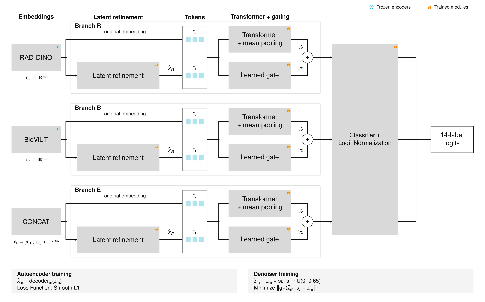

# Integrating Unimodal and Vision-Language Representations in Latent Space for Multi-Label Chest X-Ray Classification

[](https://arxiv.org/abs/2609.09185)
[](LICENSE)


> _A latent hybrid fusion framework that refines frozen RAD-DINO and BioViL-T embeddings separately in latent space before fusing them for 14-label chest X-ray classification on MIMIC-CXR-JPG._

---

## 🚀 Overview



---

## ⚙️ Environment Setup

```bash
conda create -n cxr-fusion python=3.10
conda activate cxr-fusion
pip install torch --index-url https://download.pytorch.org/whl/cu121
pip install -e .
```

The code requires Python 3.10+ and PyTorch 2.1+; select the PyTorch build matching your CUDA version, or the CPU build. [`requirements.txt`](requirements.txt) lists minimum dependency versions.

---

## 🧾 Data Preparation

This repository ships no data. Obtain credentialed access to [MIMIC-CXR-JPG v2.1.0](https://physionet.org/content/mimic-cxr-jpg/2.1.0/), extract study-level embeddings with frozen [RAD-DINO](https://huggingface.co/microsoft/rad-dino) and [BioViL-T](https://huggingface.co/microsoft/BiomedVLP-BioViL-T), and point the `paths:` block of your config to the two embedding caches.

```bash
cp configs/default.yaml configs/my_env.yaml
python scripts/prepare_data.py --config configs/my_env.yaml
```

`prepare_data.py` aligns the two caches into one study-level cohort with the 14 CheXpert labels.

---

## 🧪 Experiments

```bash
python scripts/train.py            --config configs/my_env.yaml
python scripts/analyze_results.py  --config configs/my_env.yaml
python scripts/generate_report.py  --config configs/my_env.yaml
```

The three scripts train the branches across five seeds, produce the figures and statistical tests, and assemble the manuscript tables. All outputs are written to `./outputs/checkpoints/<case_name>/`. Training is resumable: completed branch and seed runs are cached and skipped on rerun.

---

## 🔁 Reproducibility

All experiments use five fixed seeds and a deterministic patient-grouped temporal split (70% / 10% / 20%) shared across seeds. Results are reported as mean (95% CI) across seeds, with three prespecified paired comparisons on macro AUROC and mAP tested at p < 0.001.

---

## 📂 Repository Structure

```
configs/default.yaml      # hyperparameters, seeds, and input/output paths
data/README.md            # requirements for the RAD-DINO and BioViL-T embedding caches
figures/                  # architecture figure
pyproject.toml            # package metadata and dependencies
requirements.txt          # minimum dependency versions

scripts/
    prepare_data.py       # align the two embedding caches into one cohort
    train.py              # train the three branches per seed and evaluate the four configurations
    analyze_results.py    # figures, confidence intervals, and paired tests
    generate_report.py    # manuscript tables and their manifest

src/cxr_fusion/
    config.py             # typed configuration loaded from YAML
    utils.py              # seeding and identifier normalization
    data.py               # cache loading, cohort alignment, and label derivation
    representation.py     # linear-probe diagnostic of the raw embeddings
    datasets.py           # in-memory feature dataset
    models.py             # autoencoder, latent denoiser, and Transformer classifier
    losses.py             # asymmetric loss and mixup
    splits.py             # patient-grouped temporal split
    train.py              # three-stage branch training with checkpoint averaging
    fusion.py             # logit normalization, fusion weights, and thresholds
    evaluate.py           # seed-level aggregation, confidence intervals, and paired tests
    figures.py            # heatmap, ROC curves, and bar chart
    report.py             # hyperparameter, split, and manuscript tables
```

---

## 📌 Status

This release contains the complete pipeline for the four principal configurations, from cohort construction and branch training to evaluation, figures, and manuscript tables.

---

## 📄 License

MIT — see [`LICENSE`](LICENSE). This covers the code only; MIMIC-CXR, VinDr-CXR, RAD-DINO, and BioViL-T remain under their own respective licenses and data use agreements.

---

## ❤️ Acknowledgements

We gratefully build upon and acknowledge the following open-source projects and datasets:

- [**RAD-DINO**](https://huggingface.co/microsoft/rad-dino) — unimodal chest X-ray image encoder
- [**BioViL-T**](https://huggingface.co/microsoft/BiomedVLP-BioViL-T) — vision-language chest X-ray encoder
- [**MIMIC-CXR-JPG**](https://physionet.org/content/mimic-cxr-jpg/2.1.0/) — the chest X-ray dataset and CheXpert-style labels used for all internal experiments
- [**VinDr-CXR**](https://physionet.org/content/vindr-cxr/1.0.0/) — the external validation cohort
